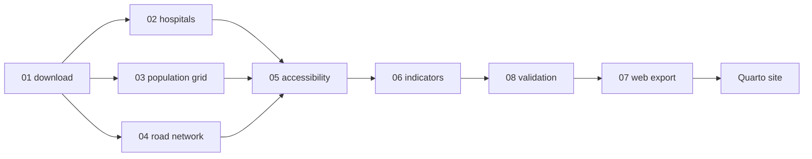

# Iran Health Accessibility Atlas

**اطلس دسترسی به بیمارستان در ایران**

> What proportion of Iran's population can reach a hospital within 15, 30, 60 and 120 minutes by car?

An open, fully reproducible accessibility observatory. It routes from every populated 1 km cell in Iran to the nearest hospital on the OpenStreetMap road network, summarises the results by province, county and nationally, checks them automatically, and publishes an interactive dashboard.

**Live site:** https://alirezach.github.io/iran-health-atlas/

## Quick start (clean machine)

Requirements: R >= 4.3, [Quarto](https://quarto.org) >= 1.5, GDAL/GEOS/PROJ system libraries (needed by `sf` and `terra`), ~25 GB free disk, 16 GB RAM, internet access.

```bash
git clone https://github.com/alirezach/iran-health-atlas.git
cd iran-health-atlas
Rscript -e 'install.packages("renv"); renv::activate(); renv::restore(prompt = FALSE)'
Rscript -e 'targets::tar_make()'
quarto render
```

The site is written to `_site/`. A full national build takes roughly 1 to 2 hours on 4 cores.

> **About `renv.lock`.** The lockfile is regenerated by the *Data refresh* workflow from the exact package versions that built the published data, then committed back. Until that first run completes it only pins R and the package repository; in that state use `Rscript -e 'renv::install()'` (reads `DESCRIPTION`) instead of `restore()`.

## Data sources

| Layer | Source | Version | Licence |
|---|---|---|---|
| Roads, hospitals | [Geofabrik](https://download.geofabrik.de/asia/iran.html) `iran-latest.osm.pbf` (OpenStreetMap) | latest, refreshed monthly (md5 recorded) | ODbL 1.0 |
| Population | [WorldPop](https://hub.worldpop.org/geodata/summary?id=36832) 2020, 1 km, UN-adjusted (+100 m for centroid weights) | 2020 | CC BY 4.0 |
| Provinces, counties | [geoBoundaries](https://www.geoboundaries.org) gbOpen ADM1 / ADM2 | current API release | CC BY 4.0 |

All downloads are automatic. Provenance (URL, version, retrieval time, size, md5, licence) is written to `data-processed/metadata.csv`. geoBoundaries was chosen over GADM because GADM's licence does not allow redistribution of derived boundary data.

## Workflow



| Stage | Script | Output |
|---|---|---|
| 01 | `scripts/01_download_data.R` | raw OSM, WorldPop, geoBoundaries + `metadata.csv` |
| 02 | `scripts/02_extract_hospitals.R` | `hospitals.parquet` (deduplicated, inside Iran) |
| 03 | `scripts/03_population_grid.R` | `population_grid.parquet` (1 km, weighted centroids) |
| 04 | `scripts/04_build_network.R` | `data-intermediate/road_graph.parquet` |
| 05 | `scripts/05_accessibility.R` | `travel_times.parquet` |
| 06 | `scripts/06_indicators.R` | `province_metrics.parquet`, `county_metrics.parquet`, `national_metrics.parquet` |
| 08 | `scripts/08_validation.R` | `data-quality-report.html`, `qa_checks.csv` |
| 07 | `scripts/07_geojson_export.R` | `travel_time.geojson`, `province_metrics.geojson`, PNG overlays, downloads |

The pipeline is a [targets](https://docs.ropensci.org/targets/) graph (`_targets.R`):

- **Rebuild from scratch:** `targets::tar_destroy(); targets::tar_make()`
- **Partial rebuild:** `targets::tar_make(names = travel_times_file)` or `Rscript scripts/05_accessibility.R`
- **Caching:** unchanged targets are skipped. The OSM md5 is checked on every run, so a new extract rebuilds only what depends on it.

Every analytical choice (speeds, thresholds, dedup distance, QA limits) is in [`config.yml`](config.yml). Method details: [docs/methodology.md](docs/methodology.md). Column definitions: [docs/data-dictionary.md](docs/data-dictionary.md).

## Repository layout

```
R/                  package code (pure, tested helpers)
scripts/            pipeline stages 01-08 (called by _targets.R)
dashboard/          Quarto pages: index, map, provinces, methodology, downloads
assets/             theme (SCSS), map controller (JS), post-render hook
tests/testthat/     unit tests
docs/               methodology.md, data-dictionary.md
data-raw/           downloads (git-ignored)
data-intermediate/  cached network graph (git-ignored)
data-processed/     published datasets (git-ignored; attached to releases)
.github/workflows/  CI, deployment, monthly refresh
```

## Deployment

1. Repository **Settings → Pages → Build and deployment → Source: GitHub Actions** (one-time).
2. Run **Actions → Data refresh → Run workflow** (it also runs automatically when pipeline code changes on `main`). It builds the data, publishes a `data-YYYY-MM-DD` release with every dataset, refreshes `renv.lock`, and deploys the site.
3. After that, each push to `main` re-renders the site from the latest data release in a few minutes.

| Workflow | Trigger | Does |
|---|---|---|
| `ci.yml` | pull requests | R CMD check, lintr, testthat |
| `deploy.yml` | push to `main`, manual, called by refresh | render Quarto with the latest data release, deploy Pages |
| `data-refresh.yml` | monthly (3rd, 02:00 UTC), manual, pipeline changes | latest OSM, full rebuild + QA, release, lockfile, deploy |

## Tests

```r
testthat::test_local()
```

Covers hospital extraction and deduplication, grid construction and weighted centroids, routing (times, distances, one-way rules, connectors) and summary indicators (coverage, quantiles, Gini, Theil). Tests use synthetic data and need no downloads.

## Licence and citation

Code: MIT. Data: outputs derived from OpenStreetMap are ODbL 1.0 (© OpenStreetMap contributors); WorldPop and geoBoundaries inputs are CC BY 4.0. See [CITATION.cff](CITATION.cff).

Contributions welcome: [CONTRIBUTING.md](CONTRIBUTING.md).
